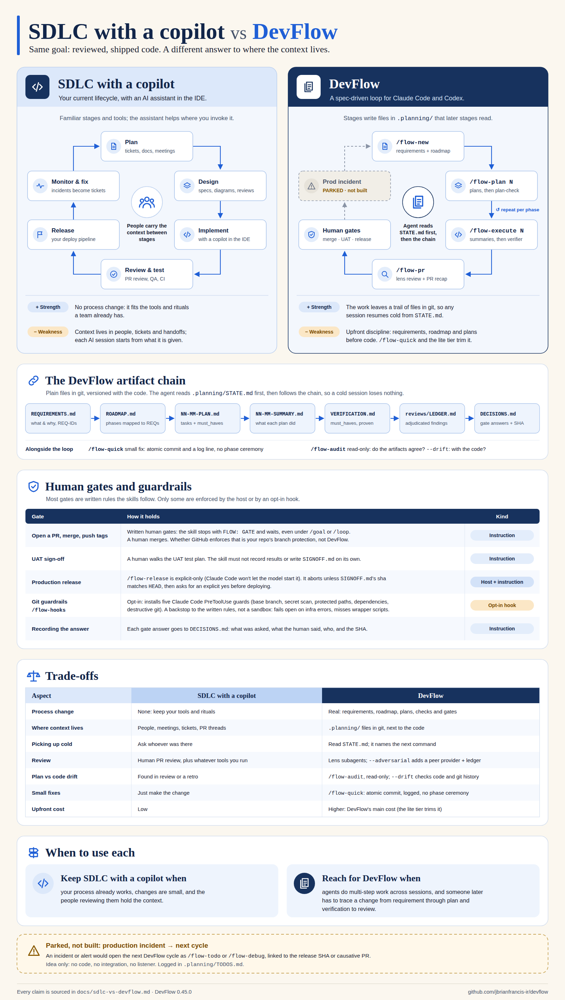

# SDLC with a copilot vs DevFlow

A one-page comparison of a conventional lifecycle with an AI coding assistant against the DevFlow loop. The editable source is [`assets/sdlc-vs-devflow.svg`](assets/sdlc-vs-devflow.svg). The PNG is a static render of it, made with `google-chrome --headless --screenshot --window-size=1600,2830`. The left column describes a typical process and is not a claim about any specific tool. Every DevFlow claim maps to a source below. If a source changes, update the chart.

## Source map

| Chart claim | Source |
|---|---|
| Spec-driven loop for Claude Code and Codex; `/flow-new` → plan → execute → PR → merge → UAT → release | [README](../README.md) (intro, Quick start) |
| `/flow-new` writes requirements and roadmap; `/flow-plan` writes and checks plans; `/flow-execute` runs executors, then a separate verifier | [README](../README.md) (Quick start), [execution-model.md](execution-model.md) (Graph execution) |
| Chain files: REQUIREMENTS, ROADMAP, `NN-MM-PLAN`, `NN-MM-SUMMARY`, VERIFICATION | `.planning/phases/` in this repo; [`flow-audit`](../plugins/devflow/skills/flow-audit/SKILL.md) reads exactly this set |
| Agent reads `STATE.md` first; a cold session resumes from disk | [execution-model.md](execution-model.md) (State), [`agent-pointer.md`](../plugins/devflow/templates/agent-pointer.md) |
| `/flow-pr`: lens review and a narrative PR recap | [`flow-pr`](../plugins/devflow/skills/flow-pr/SKILL.md) step 4, [review.md](review.md) |
| `reviews/LEDGER.md`: adjudicated findings (`--adversarial`) | [review.md](review.md) (Ledger rules), [`adjudication.md`](../plugins/devflow/references/adjudication.md) |
| Gate answers recorded in `DECISIONS.md` with who and SHA | [`autonomy.md`](../plugins/devflow/references/autonomy.md) (Human gates) |
| Open PR, merge, push tags, UAT sign-off and release are human gates written into the skills; `FLOW: GATE` stops `/goal` and `/loop` | [`autonomy.md`](../plugins/devflow/references/autonomy.md) (Status line, Human gates) |
| UAT: the skill must not record results or write `SIGNOFF.md` on its own | [`flow-uat`](../plugins/devflow/skills/flow-uat/SKILL.md) |
| `/flow-release` is explicit-only, aborts unless SIGNOFF `sha` equals `HEAD`, and asks for an explicit yes | [`flow-release`](../plugins/devflow/skills/flow-release/SKILL.md), [`autonomy.md`](../plugins/devflow/references/autonomy.md) (Explicit-only skills), [`hosts.md`](../plugins/devflow/references/hosts.md) (Host capabilities: Claude enforces it, Codex unverified) |
| `/flow-hooks`: opt-in, five PreToolUse guards, a backstop that fails open and misses wrapper scripts | [hooks.md](hooks.md), [`flow-hooks`](../plugins/devflow/skills/flow-hooks/SKILL.md) |
| `/flow-audit` is read-only; `--drift` checks the plan against code and git history | [`flow-audit`](../plugins/devflow/skills/flow-audit/SKILL.md), [README](../README.md) (Commands) |
| `/flow-quick`: atomic commit and a log line, no phase ceremony | [`flow-quick`](../plugins/devflow/skills/flow-quick/SKILL.md) |
| Upfront cost; lite tier and `/flow-quick` trim it | [`flow-new`](../plugins/devflow/skills/flow-new/SKILL.md) step 2a (right-size, lite tier) |
| Incident opens the next cycle: **parked, not built** | `.planning/TODOS.md` (2026-11-08 entry) |

## What the chart does not claim

- DevFlow is not a full agentic lifecycle. It stops at release and does not watch production. The incident → next-cycle link is a parked idea only.
- Merge enforcement on GitHub comes from the repo's branch protection, not from DevFlow.
- The chart includes no productivity or quality statistics.
